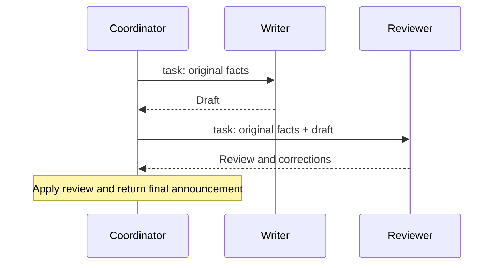
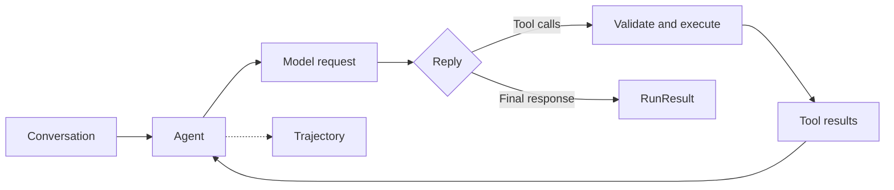

# Agent Core

**Explicit conversations. Validated tools. Bounded execution.**

[](https://github.com/2-mo/agent-core/actions/workflows/tests.yml)
[](pyproject.toml)
[](LICENSE)

[简体中文](README.zh-CN.md) · [Architecture](docs/architecture.md) · [API guide](docs/api.md) · [Examples](examples/README.md)

Agent Core is a small Python library for agents that call tools, keep explicit conversation history, and return structured execution traces. Connect a Chat Completions compatible model, register Python functions, and run a bounded model/tool loop.

## What you can build

| Capability | Interface |
| --- | --- |
| A tool-using assistant | `Agent(model, tools=[...]).run(task)` |
| A shared conversation | `Conversation`, `model.chat(...)` |
| A team of specialized agents | `specialist.as_tool()` |
| Concurrent independent tasks | `agent.run_many(...)` |
| Streaming text and tool events | `agent.run_stream(...)` |
| Inspectable execution | `RunResult`, `TrajectoryRecord` |

Tools are validated against JSON Schema before execution. Runs support turn, request, time, and reported-token budgets. Delegated agents share their parent's request and token accounting.

## Install

Requires Python 3.12 or later and [uv](https://docs.astral.sh/uv/).

```bash
git clone https://github.com/2-mo/agent-core.git
cd agent-core
uv sync
```

Try the complete tool loop without a model account or network request:

```bash
uv run python examples/offline_tools.py
```

```text
The answer is 42.
Success: True; model calls: 2
Transitions: model, tool, model
```

This example uses an explicitly scripted local model stub. The tool registration, validation, execution, budgets, and trajectory are the real runtime.

## Connect a model

Set your provider's endpoint, model name, and credentials in your shell. `.env.example` documents the variable names; files are not loaded automatically.

```bash
export MODEL_BASE_URL="https://your-provider.example/v1"
export MODEL_NAME="your-model"
export MODEL_API_KEY="your-api-key"
uv run python examples/tool_agent.py
```

```python
import os
from agent_core import Agent, ChatModel


def multiply(a: int, b: int) -> int:
    """Multiply two integers exactly."""
    return a * b


with ChatModel(
    model=os.environ["MODEL_NAME"],
    base_url=os.environ["MODEL_BASE_URL"],
    api_key=os.environ.get("MODEL_API_KEY"),
) as model:
    agent = Agent(
        model,
        tools=[multiply],
        instructions="Use the tool for multiplication.",
        max_turns=6,
        max_calls=8,
    )
    result = agent.run("What is 17 times 23?")
    print(result.text if result.ok else result.termination.reason)
```

The endpoint must support the features you request, including function tools and streaming when used. Each request is sent once; errors are returned through the run result.

## Multi-agent interaction

Expose specialists with `as_tool()` so a coordinator can delegate through the same validated tool loop. This example asks a writer to draft an announcement, passes the facts and draft to a reviewer, then incorporates the review into the final answer:



```python
import os
from agent_core import Agent, ChatModel

with ChatModel(
    model=os.environ["MODEL_NAME"],
    base_url=os.environ["MODEL_BASE_URL"],
    api_key=os.environ.get("MODEL_API_KEY"),
    timeout=120, temperature=0, max_tokens=512,
) as model:
    writer = Agent(
        model, name="writer", max_turns=3, max_calls=3,
        instructions="Write a short announcement from the supplied facts. Do not invent details.",
    )
    reviewer = Agent(
        model, name="reviewer", max_turns=3, max_calls=3,
        instructions="Check the draft against the supplied facts. Flag unsupported details and suggest corrections.",
    )
    coordinator = Agent(
        model, name="coordinator",
        tools=[writer.as_tool(), reviewer.as_tool()],
        max_turns=6, max_calls=10,
        instructions=(
            "First send the facts to writer. Then send the original facts and writer's draft "
            "to reviewer. Use the review to return the final announcement."
        ),
    )
    result = coordinator.run(
        "Announce: The meeting has moved to Friday. No time or location has been confirmed."
    )
    print(result.text if result.ok else result.termination.reason)
    print("Total model calls:", result.model_calls)
    for child in result.children:
        print(child.trajectory.rollout_metadata["agent"], child.ok, child.text)
```

Each delegation takes a `{"task": "..."}` argument and starts a separate child conversation. The coordinator must include the facts and prior outputs the child needs. Child responses return as tool results; full child traces are available in `result.children`. The parent's `max_calls=10` caps model requests across the whole team, and `result.model_calls` includes child requests. Configured token budgets also account for delegated work.

The diagram shows the requested workflow; the model chooses the actual calls and wording. Run [the complete example](examples/delegation.py) to print the recorded tasks, replies, and child outcomes:

```bash
uv run python examples/delegation.py
```

## Model backend deployment

Agent Core connects to an HTTP model server; install and run the inference backend separately from this project's `uv` environment. All three agents above can share one model endpoint. Separate models or replicas are optional.

These are suggested starting points; choose using your hardware and measurements on your own agent tasks:

| Backend | Suggested use |
| --- | --- |
| [vLLM](https://docs.vllm.ai/en/stable/getting_started/quickstart/) | A starting choice for a new GPU deployment. Verify the model's tool parser and chat template. |
| [SGLang](https://docs.sglang.io/docs/get-started/install) | Another GPU serving option, especially if already used in your stack. Compare tool success, throughput, and tail latency on the same workload. |
| [Ollama](https://docs.ollama.com/api/openai-compatibility) | Local development through `http://localhost:11434/v1`; choose a model with tool support and validate the full tool loop. |
| Managed Chat Completions service | A way to start without operating a GPU server; configure the provider's URL, model, and credentials. |

After installing a backend for your hardware, run **one** of the following commands in its own environment. Both use `Qwen/Qwen2.5-7B-Instruct` as a concrete tool-calling example, with an 8,192-token context and the API model name `agent-model`. Size the model and context for available memory.

For vLLM, Qwen2.5 uses the `hermes` parser and automatic tool choice must be enabled. See [vLLM tool calling](https://docs.vllm.ai/en/stable/features/tool_calling/).

```bash
vllm serve Qwen/Qwen2.5-7B-Instruct \
  --host 127.0.0.1 --port 8000 \
  --served-model-name agent-model \
  --max-model-len 8192 \
  --enable-auto-tool-choice \
  --tool-call-parser hermes
```

For SGLang, use its Qwen parser (`qwen`; older versions use the `qwen25` name). See [SGLang tool parsers](https://docs.sglang.io/docs/advanced_features/tool_parser) and [server arguments](https://docs.sglang.io/docs/advanced_features/server_arguments). Parser names and chat templates depend on the backend version and model family; check them when changing models.

```bash
python -m sglang.launch_server \
  --model-path Qwen/Qwen2.5-7B-Instruct \
  --host 127.0.0.1 --port 8000 \
  --served-model-name agent-model \
  --context-length 8192 \
  --tool-call-parser qwen
```

Once the server is ready, use another terminal in this repository:

```bash
export MODEL_BASE_URL="http://127.0.0.1:8000/v1"
export MODEL_NAME="agent-model"
unset MODEL_API_KEY  # These local server commands do not enable API-key authentication.
uv run python examples/tool_agent.py
uv run python examples/delegation.py
```

`MODEL_BASE_URL` ends at `/v1`; the client appends `/chat/completions`. For a server configured with authentication, set `MODEL_API_KEY` to its key.

- **Verify tool calls first.** A successful text reply does not establish tool support. Check that `tool_agent.py` executes `multiply` and that delegation prints child results. If calls appear as plain text, check the server's parser and chat template. Test `examples/streaming.py` separately when using streaming.
- **Start with modest limits.** Try an 8K context, `max_tokens=512`, and `request_concurrency=2` in `run_many()`, then adjust for latency and memory. Include history, tool schemas, tool outputs, and generated tokens in context sizing. `max_calls` limits model requests across a run; `max_total_tokens` limits cumulative reported usage and requires server usage data.
- **Tune the right concurrency.** `run_many(concurrency=...)` controls active tasks; `request_concurrency` bounds in-flight model requests within that batch, including delegates; `tool_concurrency` controls tools within a turn. `ChatModel(concurrency=...)` is a capacity hint for automatic batch admission, not a global request limiter. Keep the draft/review workflow sequential because review depends on the draft.
- **Make deployments reproducible.** Pin the backend version or image, model revision, parser, and template after validation. Inference packages and CUDA/PyTorch dependencies belong in the server environment; install only this project's dependencies in the Agent Core environment.

## Unified tool contract

Python functions, declarative tools, and delegated agents share one execution path: register a schema, parse and validate a call, execute the handler, and normalize the result. The runtime pairs results with calls and records the conversation and trajectory.

| Authoring form | Agent entry |
| --- | --- |
| Typed function | `tools=[lookup]` |
| Declarative class | `tools=[LookupTool().to_function_tool()]` |
| Specialized agent | `tools=[specialist.as_tool()]` |

Tools report `success`, a recoverable `failed`, or an execution `error`. That shared vocabulary lets the runtime compose capabilities and make completion decisions consistently. See [Tool design](docs/tool-design.md) for the contracts, calling sequence, and examples.

## Execution model



`ask()` performs one model request. `chat()` also updates an explicit conversation. `Agent.run()` owns the repeated model/tool loop. Tools return facts; the runtime handles scheduling, messages, limits, and recording.

## Examples and documentation

- [Offline tool loop](examples/offline_tools.py): run immediately with a scripted model.
- [Local document catalog](examples/local_catalog.py): search files, observe argument correction, and save a trace offline.
- [Tool-using agent](examples/tool_agent.py): connect your own endpoint.
- [Multi-agent interaction](examples/delegation.py): coordinate writing and review, and inspect the exchanges.
- [Streaming](examples/streaming.py): read events as they arrive.
- [API guide](docs/api.md): tools, conversations, budgets, batching, and traces.
- [Tool design](docs/tool-design.md): one contract for functions, declarative tools, and agents.
- [Architecture](docs/architecture.md): contracts, execution flow, and extension points.

## Development

```bash
uv sync --locked
uv run pytest -q
uv build
```

Tests use local model stubs and HTTP mock transports. They cover execution contracts, tool validation, delegation, limits, concurrent tasks, streaming, and trajectory persistence. See [CONTRIBUTING.md](CONTRIBUTING.md) for the contribution workflow.

## License

Apache-2.0. See [LICENSE](LICENSE).
