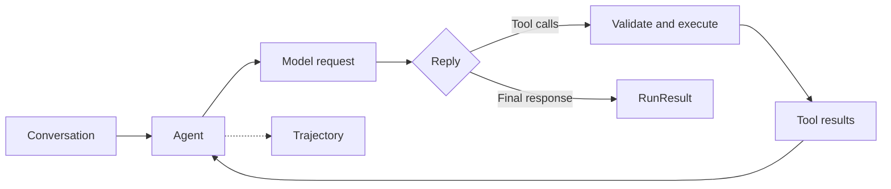

# Agent Core

**Explicit conversations. Validated tools. Bounded execution.**

[](https://github.com/2-mo/agent-core/actions/workflows/tests.yml)
[](pyproject.toml)
[](LICENSE)

[简体中文](README.zh-CN.md) · [Architecture](docs/architecture.md) · [API guide](docs/api.md) · [Examples](examples/README.md)

Agent Core is a small Python library for agents that call tools, keep explicit conversation history, and return structured execution traces. Connect a Chat Completions compatible model, register Python functions, and run a bounded model/tool loop.

## What you can build

| Capability | Interface |
| --- | --- |
| A tool-using assistant | `Agent(model, tools=[...]).run(task)` |
| A shared conversation | `Conversation`, `model.chat(...)` |
| A team of specialized agents | `specialist.as_tool()` |
| Concurrent independent tasks | `agent.run_many(...)` |
| Streaming text and tool events | `agent.run_stream(...)` |
| Inspectable execution | `RunResult`, `TrajectoryRecord` |

Tools are validated against JSON Schema before execution. Runs support turn, request, time, and reported-token budgets. Delegated agents share their parent's request and token accounting.

## Install

Requires Python 3.12 or later and [uv](https://docs.astral.sh/uv/).

```bash
git clone https://github.com/2-mo/agent-core.git
cd agent-core
uv sync
```

Try the complete tool loop without a model account or network request:

```bash
uv run python examples/offline_tools.py
```

```text
The answer is 42.
Success: True; model calls: 2
Transitions: model, tool, model
```

This example uses an explicitly scripted local model stub. The tool registration, validation, execution, budgets, and trajectory are the real runtime.

## Connect a model

Set your provider's endpoint, model name, and credentials in your shell. `.env.example` documents the variable names; files are not loaded automatically.

```bash
export MODEL_BASE_URL="https://your-provider.example/v1"
export MODEL_NAME="your-model"
export MODEL_API_KEY="your-api-key"
uv run python examples/tool_agent.py
```

```python
import os
from agent_core import Agent, ChatModel


def multiply(a: int, b: int) -> int:
    """Multiply two integers exactly."""
    return a * b


with ChatModel(
    model=os.environ["MODEL_NAME"],
    base_url=os.environ["MODEL_BASE_URL"],
    api_key=os.environ.get("MODEL_API_KEY"),
) as model:
    agent = Agent(
        model,
        tools=[multiply],
        instructions="Use the tool for multiplication.",
        max_turns=6,
        max_calls=8,
    )
    result = agent.run("What is 17 times 23?")
    print(result.text if result.ok else result.termination.reason)
```

The endpoint must support the features you request, including function tools and streaming when used. Each request is sent once; errors are returned through the run result.

## Unified tool contract

Python functions, declarative tools, and delegated agents share one execution path: register a schema, parse and validate a call, execute the handler, and normalize the result. The runtime pairs results with calls and records the conversation and trajectory.

| Authoring form | Agent entry |
| --- | --- |
| Typed function | `tools=[lookup]` |
| Declarative class | `tools=[LookupTool().to_function_tool()]` |
| Specialized agent | `tools=[specialist.as_tool()]` |

Tools report `success`, a recoverable `failed`, or an execution `error`. That shared vocabulary lets the runtime compose capabilities and make completion decisions consistently. See [Tool design](docs/tool-design.md) for the contracts, calling sequence, and examples.

## Execution model



`ask()` performs one model request. `chat()` also updates an explicit conversation. `Agent.run()` owns the repeated model/tool loop. Tools return facts; the runtime handles scheduling, messages, limits, and recording.

## Examples and documentation

- [Offline tool loop](examples/offline_tools.py): run immediately with a scripted model.
- [Local document catalog](examples/local_catalog.py): search files, observe argument correction, and save a trace offline.
- [Tool-using agent](examples/tool_agent.py): connect your own endpoint.
- [Agent delegation](examples/delegation.py): expose a specialist as a tool.
- [Streaming](examples/streaming.py): read events as they arrive.
- [API guide](docs/api.md): tools, conversations, budgets, batching, and traces.
- [Tool design](docs/tool-design.md): one contract for functions, declarative tools, and agents.
- [Architecture](docs/architecture.md): contracts, execution flow, and extension points.

## Development

```bash
uv sync --locked
uv run pytest -q
uv build
```

Tests use local model stubs and HTTP mock transports. They cover execution contracts, tool validation, delegation, limits, concurrent tasks, streaming, and trajectory persistence. See [CONTRIBUTING.md](CONTRIBUTING.md) for the contribution workflow.

## License

Apache-2.0. See [LICENSE](LICENSE).
