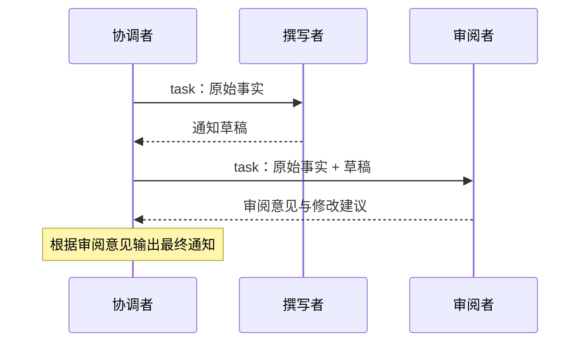

# Agent Core

**显式对话、工具契约与有边界的 Agent 执行。**

[English](README.md) · [架构说明](docs/architecture.md) · [API 指南](docs/api.md) · [示例](examples/README.md)

Agent Core 是一个通用 Python Agent 库。将兼容 Chat Completions 的模型与 Python 工具组合，即可运行多轮任务，并获得结构化的执行轨迹。

## 主要能力

| 能力 | 入口 |
| --- | --- |
| 工具调用与参数校验 | 普通 Python 函数、`ToolRegistry`、JSON Schema |
| 显式对话与分叉 | `Conversation`、`fork()`、`snapshot()` |
| 多轮 Agent 执行 | `Agent.run()` |
| Agent 委派 | `Agent.as_tool()` |
| 独立任务并发 | `Agent.run_many()` |
| 流式文本与工具事件 | `Agent.run_stream()` |
| 预算与终止原因 | 轮数、请求数、时间、服务端报告的 token 用量 |
| 轨迹记录 | `RunResult`、`TrajectoryRecord`、JSONL 保存 |

## 快速开始

安装 Python 3.12 及以上版本与 [uv](https://docs.astral.sh/uv/)，然后运行：

```bash
git clone https://github.com/2-mo/agent-core.git
cd agent-core
uv sync
uv run python examples/offline_tools.py
```

离线示例使用明确编写的模型回复，实际执行工具注册、参数校验、调用、预算与轨迹记录，不需要模型账号或网络请求。

更完整的[本地目录查询示例](examples/local_catalog.py)会检索附带的 Markdown 文档，演示参数错误、反馈与修正，并将轨迹写入 `outputs/catalog-runs.jsonl`：

```bash
uv run python examples/local_catalog.py
```

模型回复与纠错顺序由本地脚本给出，文件查询和工具执行使用实际实现；运行轨迹的查看方式见[示例说明](examples/README.md)。

连接自己的模型服务时，设置：

```bash
export MODEL_BASE_URL="https://your-provider.example/v1"
export MODEL_NAME="your-model"
export MODEL_API_KEY="your-api-key"
uv run python examples/tool_agent.py
```

环境变量由 shell 管理，程序不会自动加载 `.env`。服务端需要支持使用到的功能，例如工具调用和流式响应。

## 使用方式

`model.ask(...)` 生成一次回答；`model.chat(conversation, ...)` 同时更新显式历史；`agent.run(...)` 执行完整的模型与工具循环。工具主要负责具体业务操作，运行时统一管理消息、预算、调度和轨迹。

```python
from agent_core import Agent


def multiply(a: int, b: int) -> int:
    """精确计算两个整数的乘积。"""
    return a * b


# model 使用 ChatModel 配置，完整代码见 examples/tool_agent.py。
agent = Agent(model, tools=[multiply], max_turns=6, max_calls=8)
result = agent.run("17 乘以 23 是多少？")
print(result.text if result.ok else result.termination.reason)
```

新增工具可先从普通函数开始；需要复杂约束时提供显式 schema，需要可恢复的业务拒绝时返回 `ToolResult(status="failed", ...)`。工具执行异常与预算耗尽都保留明确终止信息。

## 多 Agent 交互示例

通过 `as_tool()` 将专门的 Agent 暴露为工具，协调者就能沿用现有的参数校验与执行循环完成委派。下面让撰写者起草会议通知，再把原始事实和草稿交给审阅者，最后由协调者根据审阅意见输出通知：



设置好前文的模型环境变量后，可直接运行：

```python
import os
from agent_core import Agent, ChatModel

with ChatModel(
    model=os.environ["MODEL_NAME"],
    base_url=os.environ["MODEL_BASE_URL"],
    api_key=os.environ.get("MODEL_API_KEY"),
    timeout=120, temperature=0, max_tokens=512,
) as model:
    writer = Agent(
        model, name="writer", max_turns=3, max_calls=3,
        instructions="根据提供的事实起草简短通知，不要编造细节。",
    )
    reviewer = Agent(
        model, name="reviewer", max_turns=3, max_calls=3,
        instructions="对照提供的事实审阅草稿，指出无依据的细节并提出修改建议。",
    )
    coordinator = Agent(
        model, name="coordinator",
        tools=[writer.as_tool(), reviewer.as_tool()],
        max_turns=6, max_calls=10,
        instructions=(
            "先将原始事实交给 writer 起草通知，再将原始事实和 writer 的草稿"
            "交给 reviewer 审阅，最后根据审阅意见输出最终通知。"
        ),
    )
    result = coordinator.run("发布通知：会议改到周五，具体时间和地点尚未确定。")
    print(result.text if result.ok else result.termination.reason)
    print("模型请求总数：", result.model_calls)
    for child in result.children:
        print(child.trajectory.rollout_metadata["agent"], child.ok, child.text)
```

每次委派的参数是 `{"task": "..."}`，子 Agent 使用独立对话；协调者需要在任务中明确传入子 Agent 所需的事实与先前结果。子 Agent 的回答作为工具结果返回，完整子轨迹保存在 `result.children`。父级 `max_calls=10` 限制整个团队的模型请求总数，`result.model_calls` 也包含子 Agent 请求；配置 token 预算时同样会计入委派消耗。

图中展示的是提示词要求的流程，实际调用顺序与措辞由模型决定。[完整示例](examples/delegation.py)会打印本次运行记录的委派参数、回复与子 Agent 执行状态：

```bash
uv run python examples/delegation.py
```

## 模型后端部署建议

Agent Core 通过 HTTP 连接模型服务，推理后端应单独安装、启动，与本项目的 `uv` 环境分开。上面的三个 Agent 可以共用一个模型端点，再按需求为不同角色配置不同模型或副本。

下表是选型起点，最终按硬件条件与实际 Agent 任务的测量结果选择：

| 后端 | 建议场景 |
| --- | --- |
| [vLLM](https://docs.vllm.ai/en/stable/getting_started/quickstart/) | 新建 GPU 自部署服务时可先从它开始，确认模型对应的工具调用解析器与聊天模板。 |
| [SGLang](https://docs.sglang.io/docs/get-started/install) | 另一种 GPU 推理方案，已有相关部署时可直接复用；用相同任务比较工具成功率、吞吐和尾延迟。 |
| [Ollama](https://docs.ollama.com/api/openai-compatibility) | 本地开发与小规模验证，端点为 `http://localhost:11434/v1`；选择支持工具调用的模型并验证完整循环。 |
| 托管 Chat Completions 服务 | 希望先跑通功能、暂不运维 GPU 服务时，直接配置提供方的 URL、模型名与密钥。 |

按官方说明为硬件安装后端后，在后端自己的环境中**任选一种**启动。以下以 `Qwen/Qwen2.5-7B-Instruct` 演示工具调用，限制上下文为 8,192 token，统一将 API 模型名设为 `agent-model`；模型大小与上下文长度需要适配可用显存。

vLLM 中，Qwen2.5 使用 `hermes` 解析器，并需要启用自动工具选择，参见 [vLLM 工具调用说明](https://docs.vllm.ai/en/stable/features/tool_calling/)。

```bash
vllm serve Qwen/Qwen2.5-7B-Instruct \
  --host 127.0.0.1 --port 8000 \
  --served-model-name agent-model \
  --max-model-len 8192 \
  --enable-auto-tool-choice \
  --tool-call-parser hermes
```

SGLang 使用其 Qwen 解析器（`qwen`，旧版本名称为 `qwen25`），参见 [SGLang 工具解析器](https://docs.sglang.io/docs/advanced_features/tool_parser)与[服务端参数](https://docs.sglang.io/docs/advanced_features/server_arguments)。解析器名称和聊天模板取决于后端版本与模型系列，更换模型时需重新确认。

```bash
python -m sglang.launch_server \
  --model-path Qwen/Qwen2.5-7B-Instruct \
  --host 127.0.0.1 --port 8000 \
  --served-model-name agent-model \
  --context-length 8192 \
  --tool-call-parser qwen
```

等待服务就绪后，在另一个终端进入本项目运行：

```bash
export MODEL_BASE_URL="http://127.0.0.1:8000/v1"
export MODEL_NAME="agent-model"
unset MODEL_API_KEY  # 上面的本地启动命令未启用 API key 鉴权。
uv run python examples/tool_agent.py
uv run python examples/delegation.py
```

`MODEL_BASE_URL` 填到 `/v1` 即可，客户端会追加 `/chat/completions`。若服务端配置了鉴权，则将 `MODEL_API_KEY` 设为对应密钥。

- **先验证工具调用。** 能返回文本并不代表工具调用已接通；确认 `tool_agent.py` 实际执行了 `multiply`，委派示例输出了子 Agent 结果。若工具调用以普通文本返回，先检查服务端解析器与聊天模板。需要流式输出时，再单独运行 `examples/streaming.py` 验证。
- **从适中的预算开始。** 可先使用 8K 上下文、`max_tokens=512`，并在 `run_many()` 中设置 `request_concurrency=2`，再根据延迟和显存调整。上下文需容纳历史、工具 schema、工具输出与本次生成；`max_calls` 限制一次运行中的模型请求总数，`max_total_tokens` 限制累计报告用量且依赖服务端返回 usage。
- **区分不同的并发参数。** `run_many(concurrency=...)` 控制活动任务数；`request_concurrency` 限制该批次内同时发出的模型请求，包括子 Agent；`tool_concurrency` 控制单轮工具并发。`ChatModel(concurrency=...)` 是自动批次调度使用的容量提示，不是全局请求限流器。草稿与审阅存在依赖，应按顺序执行。
- **验证后固定部署配置。** 固定后端版本或镜像、模型 revision、解析器和模板。推理包及其 CUDA/PyTorch 依赖放在服务端环境中，Agent Core 环境只需安装本项目依赖。

## 工具调用的统一设计

普通 Python 函数、声明式工具与子 Agent 共用一条执行路径：注册 schema，解析并校验调用参数，执行具体操作，再规范化结果。运行时负责将结果与调用配对，更新对话并记录轨迹。

| 编写方式 | Agent 接入方式 |
| --- | --- |
| 带类型标注的函数 | `tools=[lookup]` |
| 声明式工具类 | `tools=[LookupTool().to_function_tool()]` |
| 专门的子 Agent | `tools=[specialist.as_tool()]` |

工具用 `success`、可纠正的 `failed` 和执行异常 `error` 表达结果，运行时据此继续执行或结束任务。新增能力可以沿用已有的校验、调度和记录流程。完整说明见[工具调用与统一契约](docs/tool-design.zh-CN.md)。

## 进一步阅读

- [示例说明](examples/README.md)：离线运行、模型接入、委派与流式输出。
- [API 指南](docs/api.md)：工具、历史、策略、预算、并发和轨迹。
- [工具调用与统一契约](docs/tool-design.zh-CN.md)：工具构建方式、调用链、结果语义与 Agent 委派。
- [架构说明](docs/architecture.md)：模块边界与扩展接口。
- [贡献说明](CONTRIBUTING.md)：开发环境与验证方式。

许可证为 [Apache-2.0](LICENSE)。
