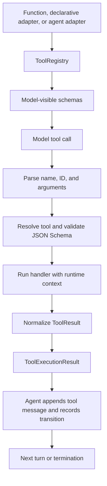

# Tool calling as a shared contract

[简体中文](tool-design.zh-CN.md) · [Architecture](architecture.md) · [API guide](api.md)

Agent Core represents callable capabilities through a shared contract: a model-visible specification, a parsed call, and a normalized execution result. Python functions, declarative tools, and delegated agents enter the same registry and execution boundary. Application code supplies the operation; the runtime handles conversation updates, scheduling, budgets, and trace records.

This makes a new capability usable by the existing agent loop without adding a separate dispatch branch or changing how results are recorded.

## What is unified

| Boundary | Contract | Responsibility |
| --- | --- | --- |
| Definition | `ToolSpec` / `Tool` | Name, description, parameter schema, executable handler |
| Invocation | `ParsedToolCall` | Call ID, tool name, parsed arguments, original arguments, repair markers |
| Outcome | `ToolResult` | Status, model-visible content, optional extra messages and state delta |
| Execution record | `ToolExecutionResult` | Outcome plus call identity, original output, error, and elapsed time |
| Conversation and trace | Tool message / `TransitionRecord` | Pair each result with its call and record what happened |

`ToolResult` describes the capability's outcome. `ToolExecutionResult` adds information about the invocation. A successful tool invocation does not by itself imply that the agent's task is finished.

## From a function to a capability

A typed Python function is the smallest authoring surface:

```python
from agent_core import ToolRegistry, ToolResult


def lookup(code: str) -> ToolResult:
    """Look up a catalog entry by code."""
    catalog = {"sample": "Example entry"}
    if code not in catalog:
        return ToolResult(status="failed", content="Unknown code. Try sample.")
    return ToolResult(content=catalog[code])


registry = ToolRegistry([lookup])
execution = registry.execute_tool_call({
    "id": "lookup-1",
    "type": "function",
    "function": {"name": "lookup", "arguments": '{"code":"sample"}'},
})
print(execution.result.status, execution.content)
# success Example entry
```

The registry adapts the function into a `FunctionTool`. Its name and docstring describe it to the model; named parameters and supported type annotations generate the parameter schema. The same function can be supplied directly to `Agent(model, tools=[lookup])`.

`registry.specs()` returns model-visible schemas. It does not expose the Python function or runtime context. `execute_tool_call()` can also be used directly, as above, without a model connection or agent loop.

Signature inference covers common scalar types, lists, dictionaries, and literals. Use `function_tool(..., parameters_schema=...)` for precise nested constraints, ranges, or nullability. Inference does not implement the entire Python type system or convert JSON values into arbitrary Python objects.

## Three authoring forms, one execution path

| Form | Register with | Use when |
| --- | --- | --- |
| Python function | `tools=[lookup]` or `function_tool(lookup, ...)` | A small operation with named inputs |
| Declarative class | `tools=[LookupTool().to_function_tool()]` | Schema, behavior, and context handling belong together |
| Delegated agent | `tools=[specialist.as_tool()]` | The capability itself needs several model/tool turns |

A declarative tool explicitly converts to the common function adapter:

```python
from agent_core import ToolRegistry, ToolResult
from agent_core.tools import DeclarativeTool


class LookupTool(DeclarativeTool):
    name = "lookup"
    description = "Look up a catalog entry by code."
    schema = {
        "type": "object",
        "properties": {"code": {"type": "string"}},
        "required": ["code"],
        "additionalProperties": False,
    }

    def action(self, context, code: str):
        if code not in context:
            return ToolResult(status="failed", content="Unknown code. Try sample.")
        return ToolResult(content=context[code])


registry = ToolRegistry([LookupTool().to_function_tool()])
execution = registry.execute_tool_call({
    "id": "lookup-2",
    "type": "function",
    "function": {"name": "lookup", "arguments": '{"code":"sample"}'},
}, context={"sample": "Example entry"})
print(execution.content)
```

For function tools, a parameter named `runtime_context` is injected by the executor and omitted from inferred schemas. `DeclarativeTool.resolve_context()` lets a class select the context its action needs. A direct registry caller supplies that context; the standard Agent supplies its run host. The model provides only the declared business arguments.

Tools may also implement `tool_name`, `schema()`, and `run(context, arguments)` directly. A common base class is not required. Domain-owned collections can implement `ToolSet` and reuse `execute_tool()` for the shared validation and result boundary.

## The calling sequence



1. **Declare.** Registration associates a name with a tool. Duplicate names are rejected unless replacement is explicit.
2. **Parse.** `parse_tool_call()` accepts an argument object or a JSON string, preserving the original arguments. A limited punctuation repair can handle quoting or commas in a complete object. It rejects repairs that change values or structure and does not complete truncated objects. Accepted repairs are identified on `ParsedToolCall.repairs`.
3. **Validate.** `execute_tool()` checks arguments against JSON Schema before invoking the handler. A string does not become an integer merely because the handler annotation says `int`.
4. **Execute.** The handler receives copied arguments and the supplied runtime context. Python behavior and external effects remain the handler's responsibility.
5. **Normalize.** Strings become text results; other ordinary values are JSON-rendered. Explicit `ToolResult` values preserve their status and extra messages. Dictionaries also support result fields such as `status`, `content`, and `error`; wrap arbitrary business dictionaries in `ToolResult(content=...)` when their keys could conflict with those fields.
6. **Commit.** The Agent pairs the result with its `tool_call_id`, appends any additional messages, and records a tool transition. The registry alone does not write conversation history.

## Failures are part of the contract

| Situation | Outcome | Standard Agent behavior |
| --- | --- | --- |
| Handler succeeds | `success` | Continue, or finish if this is the designated final tool |
| Unknown tool, unparseable arguments, schema mismatch | `failed` | Return feedback; another model turn can correct the call within the remaining budget |
| Expected business rejection | `ToolResult(status="failed", ...)` | Return the tool's explanation and continue within the budget |
| Invalid tool schema, handler exception, invalid normalized result | `error` | Record the outcome and terminate the run |

These are tool-execution outcomes. A malformed model response, including missing or duplicate tool-call IDs, can fail before tool dispatch. `failed` permits another model decision; it does not automatically retry a handler or guarantee recovery.

## An agent can be a tool

```python
from agent_core import Agent

# model is a configured ChatModel; see examples/delegation.py.
editor = Agent(model, name="editor", instructions="Edit text for clarity.")
coordinator = Agent(model, tools=[editor.as_tool()], max_calls=10)
```

`as_tool()` exposes a single `task: str` argument and runs the specialist when invoked. Its final text becomes tool content. The child run remains available in `RunResult.children`, and its trajectory links to the parent's trajectory.

When invoked by a parent Agent, the specialist shares the parent's budget lineage and request admission. Delegation therefore uses the same parameter validation, result handling, and trace path while preserving a separate child run. In the current adapter, an unsuccessful child produces a tool `error`, which terminates the standard parent run.

## What the runtime owns

- **Tool selection.** `ToolPolicy` selects schemas shown to the model and can request a particular tool. Application authorization belongs in the tool or domain host; schema selection is not an authorization mechanism.
- **Completion.** `final_tool="name"` makes successful execution of that tool a completion condition. It remains an ordinary registered tool; a separate tool kind is unnecessary.
- **Scheduling.** `tool_concurrency` controls concurrent tool execution. Completion events can arrive in completion order; conversation and trace entries are committed in the model's tool-call order. Concurrent tool effects are not rolled back when another call fails.
- **Budgets.** The runtime checks cancellation, deadlines, and model-request/token budgets. `max_calls` counts model requests, including delegated requests; it is not a count of Python tool invocations.
- **Recording.** The runtime records calls and outcomes. `messages_to_append` can add canonical messages; `state_delta` is available to domain hosts and is not automatically applied by the standard Agent.

Tool execution is ordinary Python execution. Function timeouts stop waiting but do not forcibly stop the worker. Tools sharing mutable resources must coordinate those resources themselves.

## Reading the implementation

| File | Start here for |
| --- | --- |
| [contracts.py](../src/agent_core/tools/contracts.py) | Specifications, parsed calls, and execution contracts |
| [registry.py](../src/agent_core/tools/registry.py) | Function adaptation, registration, parsing, and dispatch |
| [declarative.py](../src/agent_core/tools/declarative.py) | Class-based authoring and conversion |
| [executor.py](../src/agent_core/tools/executor.py) | Schema validation and execution outcomes |
| [types.py](../src/agent_core/tools/types.py) | Result normalization |
| [agent.py](../src/agent_core/runtime/agent.py) | Delegation, scheduling, conversation updates, and recording |

For a complete model/tool cycle without a model account, run [the offline example](../examples/offline_tools.py). For application-level usage, continue with the [API guide](api.md).
