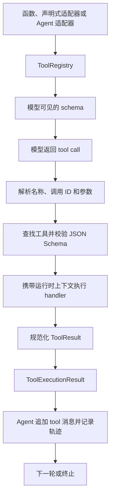

# 工具调用与统一契约

[English](tool-design.md) · [架构说明](architecture.md) · [API 指南](api.md)

Agent Core 将可调用能力表示为一套共同契约：模型可见的定义、解析后的调用，以及规范化的执行结果。普通 Python 函数、声明式工具和被委派的 Agent 都进入同一套注册与执行流程。业务代码提供具体操作，运行时管理对话更新、调度、预算和轨迹。

这样，新增一种能力时可以直接接入已有 Agent 循环，无需为它另写分发分支或结果记录方式。这也是“统一工具”的实际价值：调用方可以组合不同能力，并用一致的方式理解它们的结果。

## 统一的是哪些边界

| 边界 | 契约 | 负责表达什么 |
| --- | --- | --- |
| 工具定义 | `ToolSpec` / `Tool` | 名称、说明、参数 schema 与可执行入口 |
| 工具调用 | `ParsedToolCall` | 调用 ID、工具名称、解析后的参数、原始参数和修复标记 |
| 业务结果 | `ToolResult` | 状态、模型可读内容、可选的追加消息与状态增量 |
| 执行结果 | `ToolExecutionResult` | 业务结果，以及调用信息、原始返回值、错误和耗时 |
| 对话与轨迹 | tool 消息 / `TransitionRecord` | 将结果与调用配对，记录发生了什么 |

`ToolResult` 描述能力本身的结果，`ToolExecutionResult` 再补上这次调用的执行信息。一次工具调用成功，与整个 Agent 任务是否完成，分别由工具与运行时表达。

## 从一个函数开始

工具作者最简单的入口是带类型标注的 Python 函数：

```python
from agent_core import ToolRegistry, ToolResult


def lookup(code: str) -> ToolResult:
    """按编号查询目录条目。"""
    catalog = {"sample": "Example entry"}
    if code not in catalog:
        return ToolResult(status="failed", content="编号不存在，请使用 sample。")
    return ToolResult(content=catalog[code])


registry = ToolRegistry([lookup])
execution = registry.execute_tool_call({
    "id": "lookup-1",
    "type": "function",
    "function": {"name": "lookup", "arguments": '{"code":"sample"}'},
})
print(execution.result.status, execution.content)
# success Example entry
```

注册时，函数被适配为 `FunctionTool`。名称和文档字符串用于向模型说明能力，具名参数与支持的类型标注用于生成参数 schema。同一个函数也可以直接传给 `Agent(model, tools=[lookup])`。

`registry.specs()` 导出模型可见的 schema，Python 函数对象和运行时上下文留在本地。上面的 `execute_tool_call()` 可以脱离模型与 Agent 独立使用，因此工具接入和参数校验也可以单独调试。

签名推导支持常见标量、列表、字典与字面量类型。嵌套约束、数值范围或是否允许 `null` 等精确要求，应通过 `function_tool(..., parameters_schema=...)` 显式定义。签名推导没有实现完整的 Python 类型系统，也不会将 JSON 参数自动转换为任意 Python 对象。

## 三种编写方式，共用一条执行路径

| 编写方式 | 接入方式 | 适合的场景 |
| --- | --- | --- |
| Python 函数 | `tools=[lookup]` 或 `function_tool(lookup, ...)` | 输入明确的小型操作 |
| 声明式类 | `tools=[LookupTool().to_function_tool()]` | schema、行为与上下文处理适合集中组织 |
| Agent 委派 | `tools=[specialist.as_tool()]` | 一项能力内部需要多轮模型与工具协作 |

声明式工具通过显式转换接入共同的函数适配器：

```python
from agent_core import ToolRegistry, ToolResult
from agent_core.tools import DeclarativeTool


class LookupTool(DeclarativeTool):
    name = "lookup"
    description = "按编号查询目录条目。"
    schema = {
        "type": "object",
        "properties": {"code": {"type": "string"}},
        "required": ["code"],
        "additionalProperties": False,
    }

    def action(self, context, code: str):
        if code not in context:
            return ToolResult(status="failed", content="编号不存在，请使用 sample。")
        return ToolResult(content=context[code])


registry = ToolRegistry([LookupTool().to_function_tool()])
execution = registry.execute_tool_call({
    "id": "lookup-2",
    "type": "function",
    "function": {"name": "lookup", "arguments": '{"code":"sample"}'},
}, context={"sample": "Example entry"})
print(execution.content)
```

函数工具中名为 `runtime_context` 的参数由执行器注入，不进入推导出的 schema。声明式工具还可以通过 `resolve_context()` 选择业务操作需要的上下文。直接使用注册表时，上下文由调用方提供；标准 Agent 则传入本次运行的 host。模型只负责填写声明出来的业务参数。

自定义对象也可以直接实现 `tool_name`、`schema()` 和 `run(context, arguments)`，不需要继承共同基类。领域自己的工具集合可以实现 `ToolSet`，并复用 `execute_tool()` 提供的校验与结果处理边界。

## 一次调用如何走完整条链路



1. **声明。** 注册表将名称映射到工具。重复名称默认报错，替换已有定义需要显式指定。
2. **解析。** `parse_tool_call()` 接受参数对象或 JSON 字符串，保留原始参数。对于完整对象，可以有限修复引号或逗号；会改变值或结构的修复被拒绝，截断的对象不会被补全。接受的修复在 `ParsedToolCall.repairs` 中标记。
3. **校验。** `execute_tool()` 在执行 handler 前检查 JSON Schema。例如，模型传入字符串 `"3"`，不会因为函数标注了 `int` 就自动变成整数 `3`。
4. **执行。** handler 接收参数副本与运行时上下文，负责具体 Python 操作及外部效果。
5. **规范化。** 字符串成为文本结果，其他普通值渲染为 JSON；显式 `ToolResult` 保留状态和追加消息。字典也支持 `status`、`content`、`error` 等结果字段；业务字典的键可能与它们冲突时，应先序列化，再放进 `ToolResult(content=...)`。
6. **提交。** Agent 根据 `tool_call_id` 追加对应结果与额外消息，并记录一次工具转移。单独调用注册表不会写入对话历史。

## 失败也是契约的一部分

| 情况 | 结果 | 标准 Agent 的处理 |
| --- | --- | --- |
| handler 成功 | `success` | 继续运行；如果是指定的最终工具，则完成任务 |
| 未知工具、参数无法解析、参数不符合 schema | `failed` | 返回反馈，允许模型在剩余预算内纠正调用 |
| 预期内的业务拒绝 | `ToolResult(status="failed", ...)` | 返回工具给出的解释，在预算内继续 |
| 工具 schema 无效、handler 抛出异常、结果无法规范化 | `error` | 记录结果并终止运行 |

这个表描述工具执行边界。模型回复自身存在格式问题，例如调用 ID 缺失或重复，会在分发工具之前失败。`failed` 表示可以让模型再做一次决策，不代表自动重试 handler，也不保证最终恢复成功。

## Agent 本身也可以成为工具

```python
from agent_core import Agent

# model 是已配置的 ChatModel，完整接入见 examples/delegation.py。
editor = Agent(model, name="editor", instructions="将文字修改得清楚、简洁。")
coordinator = Agent(model, tools=[editor.as_tool()], max_calls=10)
```

`as_tool()` 向模型暴露一个 `task: str` 参数，调用发生时运行子 Agent，并将它的最终文本作为工具内容返回。子运行保留在 `RunResult.children` 中，其轨迹关联到父轨迹。

由父 Agent 调用时，子 Agent 共享父级预算链和请求准入机制。因此，委派可以沿用相同的参数校验、结果处理和轨迹流程，同时保留独立的子运行。当前适配器将子运行失败映射为工具 `error`，这会终止标准父 Agent。

## 运行时统一管理什么

- **工具选择。** `ToolPolicy` 选择本轮向模型提供哪些 schema，也可以请求指定工具。应用的授权判断放在工具或领域 host 中；schema 的选择不构成授权机制。
- **完成条件。** `final_tool="name"` 将某个工具成功执行设为任务完成条件。它仍然是普通注册工具，无需另建一种工具类型。
- **并发调度。** `tool_concurrency` 控制工具并发执行。完成事件可以按实际完成顺序发出，对话与轨迹条目按模型原始调用顺序提交。一项调用失败不会回滚其他并发工具的外部效果。
- **运行预算。** 运行时检查取消、截止时间，以及模型请求和 token 预算。`max_calls` 统计模型请求，包含子 Agent 请求，不统计普通 Python 工具的调用次数。
- **过程记录。** 运行时记录调用与结果。`messages_to_append` 可以追加规范消息；`state_delta` 留给领域 host 解释，标准 Agent 不会自动将它应用到业务状态。

工具执行仍然是普通 Python 执行。函数工具超时会停止等待，但不会强行终止工作线程。多个工具共享可变资源时，由工具实现协调这些资源。

## 对照源码阅读

| 文件 | 重点 |
| --- | --- |
| [contracts.py](../src/agent_core/tools/contracts.py) | 工具定义、解析后调用与执行契约 |
| [registry.py](../src/agent_core/tools/registry.py) | 函数适配、注册、解析和分发 |
| [declarative.py](../src/agent_core/tools/declarative.py) | 声明式编写与适配 |
| [executor.py](../src/agent_core/tools/executor.py) | 参数校验和执行结果 |
| [types.py](../src/agent_core/tools/types.py) | 结果规范化 |
| [agent.py](../src/agent_core/runtime/agent.py) | 委派、调度、对话提交和轨迹记录 |

完整的模型与工具循环可以直接运行[离线示例](../examples/offline_tools.py)，无需模型账号。应用层用法见 [API 指南](api.md)。
